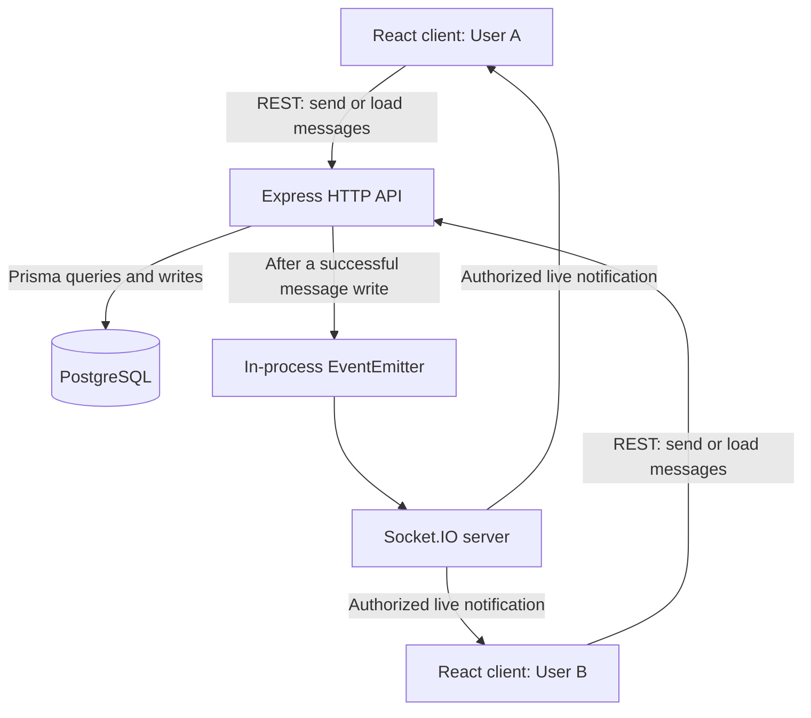

# Little Chat

A self-contained, full-stack **one-to-one real-time messaging** web application, built as a Senior Full Stack Engineer take-home assessment.

Users can sign in with a demo access secret, select another registered user, and exchange messages in real time across browser sessions. Messages are persisted in PostgreSQL, so the database—not a browser connection—is the source of truth. The application runs locally with Docker Compose and does not require an external SaaS API.

**Tech stack:** React, TypeScript, Vite, Express, PostgreSQL, Prisma, Socket.IO, TanStack Query, and Zustand.

## Quick start (reviewers)

**Prerequisite:** Docker with the Docker Compose plugin. You do not need to install Node.js or PostgreSQL on your machine.

From the repository root:

```bash
cp .env.example .env
docker compose up --build
```

> **Windows PowerShell:** Use `Copy-Item .env.example .env` instead of `cp .env.example .env` if needed.

Open **http://localhost:3000** and sign in using:

| Field | Value |
| --- | --- |
| Username | Any new name containing 3–32 letters, digits, or underscores, e.g. `alice` |
| Demo access secret | `chat-demo-2026` |

**Try real-time messaging:**

1. Sign in as `alice` in one browser profile.
2. Open another browser or a private/incognito profile and sign in as `bob` using the same demo secret. Ordinary tabs in the same browser profile share cookies.
3. Select the other user from the sidebar and send messages in both directions. Messages should appear without refreshing.

On first startup, Docker builds the frontend into the server image, waits for PostgreSQL to become healthy, generates the Prisma client, applies the database migrations, and starts the app. Database files persist in the Docker named volume `postgres_data`; the PostgreSQL port is not exposed to the host.

The default `docker compose up --build` also loads `compose.override.yaml`, which enables backend development watch mode. For a clean run of **only the base Compose configuration**, use:

```bash
docker compose -f compose.yaml up --build
```

Both commands use the **root `.env` file**. You do **not** need `server/.env` for a Docker Compose run.

To stop the app, press `Ctrl+C`. To stop and remove containers without deleting the database volume, run `docker compose down`. **Do not use `down -v` unless you intend to delete local database data.**

## Architecture



**Message lifecycle:**

1. The sender makes an authenticated HTTP request to send a message.
2. The server validates the peer, conversation membership, and message content, then persists the message in PostgreSQL.
3. **Only after persistence succeeds**, an in-process event notifies the Socket.IO layer.
4. The server delivers the saved message to active sockets belonging to the two conversation participants. The sender also receives the HTTP response.
5. Clients merge messages into their TanStack Query caches, deduplicating by server-assigned message ID.

HTTP handles message creation and history retrieval; Socket.IO handles live notifications. This keeps message persistence independent of whether a recipient is currently online.

## Engineering decisions and trade-offs

### 1. Keep integrity rules in the database

The data model consists of `User`, `Conversation`, `ConversationMember`, and `Message`.

- Direct conversations use a **unique, consistently sorted pair of user IDs**, so one pair cannot have duplicate direct conversations.
- The first message creates a conversation and its two memberships in one nested database write.
- If two participants send their first messages concurrently, one create may fail with Prisma's unique-constraint error `P2002`. The handler then retrieves the already-created conversation rather than creating a duplicate.
- Custom SQL checks and deferred triggers enforce direct-chat membership integrity. Composite foreign keys prevent messages from referencing senders who are not members of the conversation, and read pointers from referencing messages in another conversation.

**Why:** Application-side checks alone can race under concurrent requests and do not protect data written by other clients or services. Database constraints provide a final integrity boundary. Authorization is still enforced in the API, because foreign keys do not establish who is making a request.

### 2. Persist first, notify second

Messages are saved before `messages:changed` is emitted. This prevents clients from being notified about a message that failed to save.

**Trade-off:** The database commit and the notification are not one atomic operation. If the process crashes after the commit but before notification, the message remains in the database, but connected clients may miss the event until they refetch. A production evolution would use a **transactional outbox** and reliable event dispatch.

### 3. Use Socket.IO as transport, not as a messaging backend

Socket.IO handles low-level connection lifecycle, WebSocket transport, and reconnection. The application still owns its conversation model, authentication, recipient routing, input validation, persistence, and cache synchronization; it does not depend on a hosted messaging service or a framework that supplies an entire chat product.

**Trade-off:** Using Socket.IO is less low-level than implementing raw WebSocket framing and connection handling. It was chosen to keep this time-boxed MVP focused on messaging correctness and application design. The transport is configured for **WebSocket only**, with no HTTP long-polling fallback.

### 4. Refetch after reconnect; avoid blindly retrying sends

The client subscribes to live events before mounting initial chat queries. After a reconnection, it invalidates active chat queries and refetches persisted history, recovering events missed during an offline period. The history endpoint currently returns only the **latest 100 messages**, so this is not a complete catch-up or pagination system.

Messages are deduplicated by ID in the client cache. Automatic retries for **send requests** are disabled because a response can be lost even after the server commits a message; retrying could then create a duplicate.

**Production evolution:** Add client-generated idempotency keys with a database uniqueness constraint, cursor/sequence-based history synchronization, older-history pagination, and explicit delivery states.

### 5. Optimize for one local server, document the scaling boundary

The application uses a Node.js `EventEmitter` to pass persisted-message notifications to Socket.IO. It works within **one backend process**.

**Trade-off:** Replicas would not share the same in-memory event bus. A multi-instance deployment would need a shared notification mechanism (such as Redis Pub/Sub or PostgreSQL `LISTEN/NOTIFY`), plus a strategy for recovering events missed during process failures. The current broadcaster also scans connected sockets, which would need revisiting at scale.

### 6. Prefer an easily reviewable local setup

The root `.env.example` deliberately includes **working development-only sample values**, so a reviewer can start the project with minimal configuration. This is a conscious trade-off for a local assessment, **not** a production secret-management approach.

See [Development credentials and security](#development-credentials-and-security) for the limitations.

## Features and behavior

- `/signin` provides a combined demo registration/sign-in flow. New usernames create a user; existing usernames return the existing user.
- Usernames are trimmed, lowercased, unique, and limited to 3–32 ASCII letters, numbers, or underscores.
- `/chat` shows other registered users with a client-side search field.
- `/chat/:id` uses the **peer user ID** to show the direct conversation with that user.
- The first message between two users creates the conversation and both memberships.
- Messages are trimmed and limited to 4,000 characters.
- The latest 100 messages are loaded chronologically; new messages appear in real time.
- The header/logout and footer remain visible while the chat message list scrolls.
- A connection-status banner indicates when live updates are unavailable.

### Authentication and sessions

The application intentionally uses a **shared demo access secret** (`chat-demo-2026`) rather than user-specific passwords. Anyone who knows this secret can sign in under any valid username, including an existing user's username. This is suitable only for a controlled demo, **not real account ownership or private production messaging**.

The `chat_session` cookie contains a Base64URL payload and an HMAC-SHA256 signature with the user ID, username, and seven-day expiry. It is **signed, not encrypted, and not a JWT**. The cookie is `HttpOnly` and `SameSite=Strict`; `COOKIE_SECURE` controls whether it is marked `Secure`.

On page load, `/api/auth/me` validates the signed cookie and restores UI state into an in-memory Zustand store. Protected chat HTTP routes and Socket.IO handshakes also verify that the user exists. The server derives the sender identity from the cookie, not the request body. Socket handshakes are origin-checked; connected sockets are checked for expired cookies, and expired connections are disconnected.

Logout clears the cookie and the frontend disconnects its socket. There is **no per-token revocation**: a copied token remains valid until expiry or rotation of the signing secret. The embedded profile may become stale before a new token is issued.

### Live events and client state

TanStack Query stores the user/message caches. Zustand stores the current authentication UI state, and the URL stores the selected peer. These frontend caches are not persisted across a browser refresh.

| Socket event | Effect |
| --- | --- |
| `users:changed` | Emitted after login/upsert; active clients refetch the user list. |
| `messages:changed` | Carries a saved message and peer ID; sent only to sockets of the two participants. |
| `auth:expired` | Prompts the client to clear local session state and return to sign-in. |

The send HTTP response and socket notification both update the cache. The cache deduplicates by message ID, orders messages, and retains only the latest 100. Receiving a message does not require an extra history GET. Reverse proxies must forward WebSocket upgrade requests.

## Development credentials and security

Both `.env.example` files contain values meant to simplify **local development and assessment only**. The root `.env.example` is copied into `.env` for Docker Compose. Actual `.env` files are Git-ignored. The app should be run on a trusted local machine/network when these credentials are in use.

**Do not use the example signing secret, database password, or shared demo login on a public server.** Although the Compose database itself is not exposed on a host port, the web service maps port 3000 to host interfaces. A publicly reachable deployment needs independent strong secrets, real user authentication, HTTPS, appropriate network exposure, and other security hardening.

For a non-demo deployment, generate unique values, for example:

```bash
openssl rand -hex 32  # Example AUTH_SIGNING_SECRET
```

Also replace `POSTGRES_PASSWORD` with an independently generated password. Changing PostgreSQL initialization settings **does not** update the password already stored in an existing database volume.

### Environment variables

| Variable | Purpose |
| --- | --- |
| `POSTGRES_DB`, `POSTGRES_USER` | PostgreSQL database and initial user (default `chat_app`). |
| `POSTGRES_PASSWORD` | Database initialization and connection credentials; required by Compose. |
| `AUTH_SIGNING_SECRET` | HMAC key used for signed session cookies; required by Compose. |
| `COOKIE_SECURE` | `false` for local HTTP; `true` behind properly configured HTTPS. |
| `CLIENT_ORIGIN` | Permitted browser origin (defaults to `http://localhost:3000`). |
| `DATABASE_URL` | Required for backend/Prisma commands outside Docker; Compose constructs its own URL using hostname `db`. |
| `PORT` | Server port; Compose uses 3000. |

Docker Compose reads `.env` in the repository root to interpolate variables in `compose.yaml`. You can explicitly select another file using `--env-file <path>`; this is different from a service-level `env_file:` declaration.

`server/.env.example` is intended for **backend processes run outside Docker**. Its sample `DATABASE_URL` is only a placeholder: edit it to target a reachable PostgreSQL instance. The database started by the supplied Compose files is not available at `localhost:5432` unless you explicitly publish that port.

## Local development

The recommended reviewer workflow is the Docker Quick Start above. For live backend development, the default `compose.override.yaml` mounts backend source and Prisma files into the server container and starts `tsx watch`:

```bash
docker compose up --build
```

Backend source changes restart the server. The frontend build is still bundled into the server image; to refresh the frontend served on port 3000 after frontend changes, rebuild the image and refresh the browser.

For frontend hot reload, use **Node.js 22.23.4 or newer** and npm, install frontend dependencies, and start Vite in another terminal:

```bash
npm --prefix app ci
npm --prefix app run dev
```

Open the Vite URL (normally http://localhost:5173). Its development proxy forwards `/api` and `/socket.io` to the backend at port 3000, including WebSocket upgrades. Restart Vite after changing proxy configuration.

To run the backend **outside Docker**, configure `server/.env` and point `DATABASE_URL` to your own reachable PostgreSQL instance. From the `server/` directory:

```bash
npm ci
npm run db:generate
npm run db:deploy
npm run dev
```

## API

All chat endpoints require authentication.

| Method | Endpoint | Input / result |
| --- | --- | --- |
| `POST` | `/api/auth/login` | JSON `{ username, secret }`; sets the session cookie and returns `{ user }`. |
| `GET` | `/api/auth/me` | Returns `{ user }`, or `401` for an invalid/expired session. |
| `POST` | `/api/auth/logout` | Clears the cookie; returns `204`. |
| `GET` | `/api/chat/users` | Returns `{ users }`, excluding the signed-in user. |
| `GET` | `/api/chat/users/:id/messages` | Returns `{ messages }` for the selected peer. |
| `POST` | `/api/chat/users/:id/messages` | JSON `{ content }`; returns `{ message }` with status `201`. |

Message routes reject self-chat, invalid or nonexistent peer IDs, and unauthorized conversation access.

## Project structure

```text
app/src/
  components/       Shared Button, Input, Textarea and PageLayout
  lib/auth/         Authentication API, query keys and hooks
  pages/Signin/     Sign-in UI and styles
  pages/Chat/       Chat API, cache, sidebar, routing and hooks
    Conversation/   Conversation UI and nested routes
  store/            Zustand authentication state
server/src/
  auth/             Login, current-user and logout handlers
  chat/             User/message handlers and peer validation
  middleware/       Protected API authentication
  utils/            Signed-token and cookie helpers
  web-socket/       Socket.IO setup and in-process event bus
server/prisma/      Schema, versioned migrations and integrity notes
```

The code follows the **principle of proximity**: feature-specific APIs, hooks, styles, and helpers live near their consumers, while shared UI components and authentication utilities are grouped centrally. Backend and frontend tests are colocated with relevant features.

## Database and migrations

The current schema uses `User`, `Conversation`, `ConversationMember`, and `Message`. Versioned migrations include custom SQL integrity rules that are not fully expressible in the Prisma schema. Use migration files instead of `prisma db push`.

The repository retains a historical session-creation migration and the later session-removal migration. Keeping both preserves previously applied migration history; the removal drops the sessions table, not users or messages.

For schema changes, run the development configuration and generate a migration from the repository root:

```bash
docker compose exec server npm run db:migrate -- --name describe_change
docker compose restart server
```

The development override mounts Prisma source and migration files back to the host. Commit the generated migrations with the schema. `db:migrate` creates development migrations; `db:deploy` applies existing migrations on startup. See [database integrity notes](server/prisma/README.md) for the custom constraints and their implications.

## Testing and verification

### Manual verification

The application was **successfully started on a separate laptop using Docker Compose**. Real-time messaging was also **manually tested between different browsers** with different users. This supports the key requirements for local reproducibility, a functional backend, and real-time cross-session messaging.

Recommended additional manual checks (not claimed as completed here):

1. Refresh the conversation and confirm previously sent messages load from PostgreSQL.
2. Restart the backend and confirm the client reconnects and resynchronizes the latest history.
3. Log out and confirm that protected chat routes redirect to sign-in.

### Automated tests

For source-level checks, install project dependencies and generate the Prisma Client. From the repository root:

```bash
npm --prefix server ci
npm --prefix server run db:generate
npm --prefix server run typecheck
npm --prefix server test
npm --prefix app ci
npm --prefix app exec -- tsc --noEmit
npm --prefix app run build
npm --prefix app test
```

The server suites cover authentication and token tampering/expiry, chat input and membership validation, chronological history, concurrent conversation creation, and notification routing. HTTP tests use a local test listener with mocked Prisma; Socket.IO tests mock the transport boundary and database. Frontend Jest/React Testing Library tests cover shared controls, sign-in, the chat shell, sidebar, protected routing, and conversation composition.

The suite does **not** currently replace an end-to-end test against real browsers, actual WebSocket networking, or a real database/migration lifecycle.

Optional commands:

```bash
npm --prefix server run test:watch
npm --prefix server run test:coverage
npm --prefix app run test:watch
npm --prefix app run test:coverage
```

## Known limitations and path to production

This application is an **MVP, not a production-ready messaging service**. Its current trade-offs are deliberate and documented:

| Area | Current limitation | Production direction |
| --- | --- | --- |
| Account ownership | Shared demo secret permits username impersonation. | Individual password authentication, secure password hashing, rate limiting, account recovery and session controls. |
| Sessions | Signed stateless cookies cannot be individually revoked immediately. | Server-side sessions or revocation support, key rotation strategy. |
| Message delivery | No idempotency key or durable delivery acknowledgement. | Client-generated message IDs with unique constraints, acknowledgment/retry protocol. |
| History recovery | Only the newest 100 messages are fetched/refetched. | Cursor or sequence-based pagination and catch-up; explicit gap recovery. |
| Event reliability | Commit and event emission are separate. | Transactional outbox and reliable dispatch. |
| Horizontal scaling | In-process events reach only sockets on the same server. | Shared event transport plus multi-instance delivery design. |
| Additional chat features | No attachments, editing, typing indicators, online presence or read-receipt UI. | Introduce as needed after core correctness and reliability. |
| Operations | No production-grade monitoring, backups or end-to-end environment tests. | Observability, database backups, HTTPS, secrets management, CI/integration/E2E tests. |

These omissions do not prevent the current local one-to-one messaging MVP from running, but they would need prioritization against user needs and system scale before production adoption.
